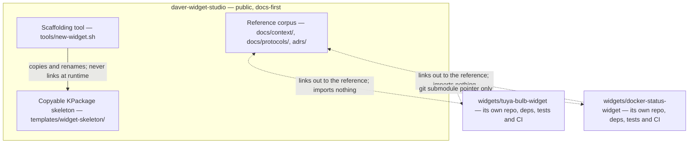

# Project Overview — daver-widget-studio

`daver-widget-studio` is a **docs-first widget studio** for KDE Plasma 6 widgets: one public
reference corpus holding everything the authoring of those widgets has taught, plus one copyable
KPackage skeleton to start a new widget from. The widgets themselves are not here — each one stays
its own repository, linked into `widgets/` as a git submodule. The human entry point is the root
[README.md](../../README.md) and the agent entry point is [docs/project.md](../project.md); this doc
carries the *why* that those two only summarise.

## The question that created it

Two widgets existed, and each carried its own documentation. The lore overlapped — the same Plasma
packaging, data-engine and severity lessons were re-derived in both — and where the two copies
overlapped they drifted. So the question was structural, and it was asked in one sentence:

> Does it make sense to group the widgets, or to write reference documentation for creating
> widgets?

The answer chosen is the second one: **write the reference documentation, and ship one copyable
skeleton beside it**. The decision record, with the alternatives costed, is
[ADR-0001](../../adrs/adr-0001-adopt-widget-studio-structure.md); the topology that completes it is
[ADR-0002](../../adrs/adr-0002-keep-widgets-as-independent-repos.md). Nothing below adds an opinion
to those two records — it only states what they decided.

| Option | Why it lost |
|---|---|
| Group the widgets into a monorepo | one build, one CI and one release cadence for widgets that share nothing at runtime; the drift is replaced by coupling |
| Extract a shared runtime core library | a core shaped by the union of two unrelated needs — one widget shells out to a Python CLI, the other runs shell commands directly — so every widget pays for the other's dependencies |
| Build a code generator | templates-as-code to maintain, and generation cannot express the per-widget judgement — a command boundary, a config key — that a copy step leaves visible |
| **Reference documentation + one copyable skeleton** | **chosen** — the only option that removes the duplication without adding coupling |

The cost of that choice is recorded rather than hidden: there is no cross-widget refactor, so a
shared improvement is a note or a skeleton change and never a patch applied in one place, and a
submodule pointer moves only when someone moves it deliberately.

## Topology

The arrows that matter are the ones that are not drawn: nothing in a widget imports anything from
this repository, because there is nothing here to import. Linking is one-directional — the studio
points at the widget repositories and links to their docs, and a widget's own doc points back at the
reference by URL (see [merge-widget-docs.md](../protocols/merge-widget-docs.md)). What each widget
demonstrates, side by side, is [widget-comparison.md](widget-comparison.md).

## Who it is for

- **The author's own future widgets.** The corpus is the thing a new widget is written against:
  [plasmoid-anatomy](plasmoid-anatomy.md) for the package, [qml-shell-js-core](qml-shell-js-core.md)
  for the boundary, [severity-and-state-model](severity-and-state-model.md) for honesty about
  state, [testing-a-plasmoid](testing-a-plasmoid.md) for proving it without a desktop. Copy the
  skeleton rather than either widget — see
  [create-a-new-widget.md](../protocols/create-a-new-widget.md).
- **Anyone reading the public reference.** A reader who has never seen the author's two widgets
  should still be able to write a correct Plasma 6 applet from this corpus alone. That is the
  standard every doc here is held to.

## What "public" changes

The studio is public, and that makes the reference a **product**, not private scaffolding. Three
consequences follow:

- **It must stand alone.** A doc that only makes sense next to the author's machine, terminal
  history or memory is a defect, not a shortcut.
- **It must be honest about gaps.** The corpus is distilled from **two** widgets, so the
  generalities are a sample, not the KDE standard — every slice doc carries a *Known gaps* section
  ([docs-corpus-slice](docs-corpus-slice.md), [skeleton-tooling-slice](skeleton-tooling-slice.md),
  [workspace-slice](workspace-slice.md)) rather than a claim of completeness.
- **It borrows upstream by URL.** The methodology is
  [`documentation-onrails` v1.4](https://github.com/DaveR-ui/documentation-onrails), referenced by
  URL; only its **schema layer** is vendored. A second copy of the guidelines would be the
  second-source-of-truth anti-pattern this studio itself documents
  ([ADR-0003](../../adrs/adr-0003-validate-js-consumer-layout.md)).

Publishing does not make the widgets public products by itself: each one keeps its own repository,
its own docs and its own license, and the studio links to them rather than hosting them.

## The reuse scope, stated plainly

**Lore and skeleton only.**

- **Lore** — the merged reference documentation under `docs/context/`, the procedures under
  `docs/protocols/`, and the decision records under `adrs/`.
- **Skeleton** — one copyable KPackage under `templates/widget-skeleton/`, copied out by
  `tools/new-widget.sh` with `@WIDGET_ID@` and `@WIDGET_NAME@` substituted.
- **No shared runtime core.** No widget links against anything in this repository, and nothing here
  is a library. A widget keeps its own code, dependencies, build and CI
  ([ADR-0002](../../adrs/adr-0002-keep-widgets-as-independent-repos.md)).

## Anti-goals

Stated so nobody adds them by accident. The root README's
[*What is NOT here*](../../README.md) section carries the full list; in short:

- no shared runtime and no core library the widgets import;
- no monorepo — `widgets/` holds submodule checkouts of independent repositories, and no widget
  source beyond the checkout itself;
- no code generator — scaffolding is **copy-and-rename**, deliberately;
- no vendored copy of the upstream guidelines — referenced by URL instead;
- no CI, build or release in the studio — those belong to each widget's own repository
  ([release-a-widget.md](../protocols/release-a-widget.md)).

## References

- [ADR-0001](../../adrs/adr-0001-adopt-widget-studio-structure.md) — the decision this doc states,
  with the alternatives costed.
- [ADR-0002](../../adrs/adr-0002-keep-widgets-as-independent-repos.md) — why the widgets stay
  independent repositories.
- [ADR-0003](../../adrs/adr-0003-validate-js-consumer-layout.md) — the validator and the two
  directories the corpus scan skips.
- [../project.md](../project.md) — the agent entry point: routing, stack, conventions, lookups.
- [context-index.md](context-index.md) — the hub for every strategic doc in this folder.
- [docs-corpus-slice](docs-corpus-slice.md), [skeleton-tooling-slice](skeleton-tooling-slice.md),
  [workspace-slice](workspace-slice.md) — the three slices, with their known gaps.
- [../../templates/widget-skeleton/README.md](../../templates/widget-skeleton/README.md) — the
  skeleton's own README, copied with every new widget.
- [../../tools/new-widget.sh](../../tools/new-widget.sh) — the one tool the studio ships.
