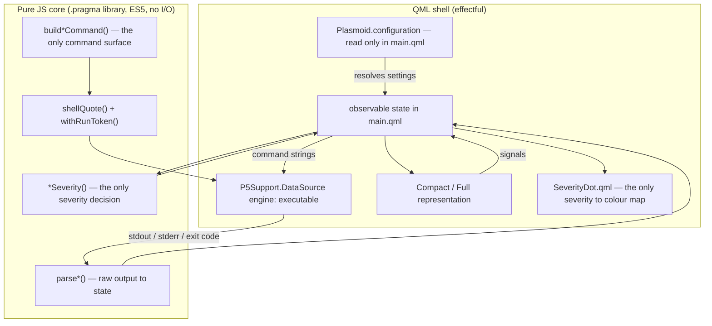

# The QML Shell and the Pure-JS Core

Every KDE Plasma 6 widget in this studio is built the same way: a thin **QML shell**
that owns the widget, and a **pure-JavaScript core** that owns the meaning. This doc
is the rule, distilled from the two widgets that implement it — `tuya-bulb-widget` and
`docker-status-widget` — and from the copyable skeleton under
[`templates/widget-skeleton/`](../../templates/widget-skeleton/README.md). Copy the
skeleton, not one of the widgets.

Both widgets are evidence. Where they differ, the difference is named below and a
preference is stated; the invariant is what a new widget must keep.

## What each side owns

**The QML shell owns the effectful world** — everything that needs a running Plasma:

| QML owns | Where, in a real widget |
|---|---|
| Reading `Plasmoid.configuration` | exactly one file: `main.qml` (see below) |
| Holding command strings and assigning them to data sources | `main.qml` only |
| Polling | `P5Support.DataSource` with `engine: "executable"` |
| Rendering | `CompactRepresentation.qml`, `FullRepresentation.qml` |
| Mapping a severity to a colour | `SeverityDot.qml`, and nowhere else |

**The core owns vocabulary and logic** — everything a bare engine can run:

| The core owns | Example |
|---|---|
| The state vocabulary (`STATE_*`) | `on` / `off` / `mixed` / `unknown` in tuya; `active` / `inactive` / `failed` / `unknown` in docker |
| Parsing raw command output into a state | `parseState()`, `parseDaemonState()`, `parseContainers()` |
| The severity decision | `statusSeverity()`, `daemonSeverity()`, `containerSeverity()` |
| Exit-code interpretation and user-facing cause text | tuya's `EXIT_MESSAGES` and `errorMessageForExitCode()` |
| Shell-quoting and command assembly | `shellQuote()`, the `build*Command()` family |
| The run-token helper | `withRunToken()` |

The dividing line is simple and worth stating as a test: if a function needs a QML
type, a `Date`, a file, a process or a socket, it belongs in QML; if it takes strings
and arrays and returns strings, numbers and plain objects, it belongs in the core.

## The core invariant

The core file is **one `.pragma library` JavaScript file** with three hard rules,
stated verbatim at the top of each one:

1. **No QML types** and no runtime API from the QML engine (`Qt.*`, `i18n()`, …) —
   they do not exist outside QML. User-facing text is chosen in the QML layer, where
   the translation helper lives; the core returns *data*.
2. **No I/O** — no process, no file, no network. The shell is reached only through the
   core's `build*Command()` functions, and `main.qml` is the only file that runs them.
3. **ES5 on purpose** (`var`, `function`, `switch`; no `let`/`const`, no arrow
   functions, no classes) — the plasmoid's engine and a bare V8 must both accept these
   exact bytes. Docker's `formatCountdown()` even pads by hand because `padStart` is
   not ES5 (`dockerstatus.js`).

Why this is worth the constraint: it is what makes the logic testable without a
desktop session. Both cores are unit-tested by evaluating the **shipped bytes** in a
bare V8 context:

- [tuyabulb.js](../../widgets/tuya-bulb-widget/plasmoid/io.github.daver-ui.tuyabulb/contents/ui/tuyabulb.js)
- [dockerstatus.js](../../widgets/docker-status-widget/package/io.github.daver-ui.dockerstatus/contents/ui/dockerstatus.js)
- [widget.js (skeleton)](../../templates/widget-skeleton/contents/ui/widget.js)

The harness strips only the `.pragma library` line and runs the rest with
`node:vm`'s `runInContext` (see
[dockerstatus.test.mjs](../../widgets/docker-status-widget/tests/dockerstatus.test.mjs)),
so what ships is what is tested.

## How the boundary is enforced — assertions, not vibes

The invariant is not a comment. Both widgets assert it, and the skeleton's suite
mirrors it:

- **The JS core is pure JS.** tuya's `test_js_module_is_pure_javascript_without_io`
  reads `tuyabulb.js` and fails if it contains `import `, `require(`, `XMLHttpRequest`,
  `fetch(`, `Qt.` or `i18n(`. It also asserts the file starts with `.pragma library`.
- **QML never reaches the shell on its own.** tuya's
  `test_qml_never_reads_files_or_shells_out_directly` scans every QML file for
  `XMLHttpRequest`, `fetch(`, `cat `, `xdg-open`, `chmod `, `rm -`, `mkdir `.
- **`main.qml` only produces commands through the builders.** tuya's
  `test_main_qml_only_produces_commands_through_the_builders` asserts that no command
  literal (`--format`, `--no-notify`, `"status"`, …) appears in `main.qml`, that every
  `connectedSources` assignment is a `Tuyabulb.*` builder call, and that the
  accumulated action lists are only ever extended with builder output.
- **Only one file reads configuration.** tuya's `test_only_main_qml_reads_configuration`
  and `test_representations_are_configuration_and_command_free`; docker's
  `"only main.qml touches Plasmoid.configuration"` test. The test file for tuya lives
  at [test_plasmoid.py](../../widgets/tuya-bulb-widget/tests/test_plasmoid.py).
- **Every symbol a QML file calls on the core is defined there.** tuya's
  `test_every_qml_tuyabulb_symbol_is_defined_in_the_js_module` — a rename in the core
  cannot leave a dead call in QML.

If you fork the skeleton and add a symbol to the core, add the assertion with it.

## Where `Plasmoid.configuration` is read

Exactly one file per widget: **`main.qml`**. It resolves every setting into a
`readonly` derived property so the rest of the widget never sees raw configuration:

```qml
// tuya main.qml
readonly property string deviceName: Tuyabulb.resolveDeviceName(Plasmoid.configuration.device)
readonly property bool   multiScope: root.scopeMode !== "device"
readonly property string severity:   Tuyabulb.statusSeverity(root.powerState, root.errorActive)
```

The representations receive state, severity and resolved values as plain properties
and emit signals back up. A representation that reads `Plasmoid.configuration` or
holds a command is a defect, and both suites fail on it.

There is one sanctioned second reader: a **config page** (`config/ConfigGeneral.qml`)
reads and writes settings through the `cfg_*` mechanism below. That is a different
channel — Plasma's config machinery — not `main.qml`'s runtime state.

## The `cfg_<entry>` alias mechanism and its gotcha

A setting exists in three places that must agree:

1. an entry in `contents/config/main.xml` (`kcfg` schema);
2. a `cfg_<entryName>` property on the config page, which Plasma binds to that entry;
3. a `Plasmoid.configuration.<entryName>` read in `main.qml`.

**The alias target must be a plain writable property.** Aliasing an *expression* is a
silent no-op on save — the page reports nothing and persists nothing. Both config
pages state this (`docker` ConfigGeneral and the skeleton's). The usual shape is an
alias to a control's value/checked/text:

```qml
property alias cfg_pollIntervalSeconds: pollInterval.value
property alias cfg_iconName: iconName.text
```

**The gotcha: a combo-box value cannot be a `cfg_` alias.** Plasma hands every stored
value to the page as an *initial property*, and that write lands before the combo has
finished initialising. The combo's own startup then adopts index 0 and rewrites its
text — so an alias reads back the first model entry, and merely opening the page can
write that over the stored value. This is not hypothetical: `docker-status-widget`
lost its `cookiesBrowser` setting to exactly this (`brave` overwrote the stored
browser).

The fix, and the pattern to copy, is a **plain property seeded in the combo's own
`Component.onCompleted`**, with the control→config push-back muted until the seed is
in. The skeleton ships it for `cfg_panelIcon` and docker for `cfg_cookiesBrowser`;
the ordering was measured on Qt 6.11.2. See
[ConfigGeneral.qml (docker)](../../widgets/docker-status-widget/package/io.github.daver-ui.dockerstatus/contents/ui/config/ConfigGeneral.qml)
and
[ConfigGeneral.qml (skeleton)](../../templates/widget-skeleton/contents/ui/config/ConfigGeneral.qml).

Two more `kcfg` facts worth carrying:

- **Add a setting in one change**: the `main.xml` entry *and* its `cfg_*` property
  together. tuya's `test_config_page_aliases_every_entry_and_has_no_combo` proves the
  two cannot drift, and asserts the page has no combo (so no alias-to-combo risk).
- **`source:` in `contents/config/config.qml` resolves relative to `contents/ui/`, not
  `contents/`.** The skeleton README records this.

## The representation split

A `PlasmoidItem` provides two surfaces and Plasma picks by form factor:

```qml
preferredRepresentation: Plasmoid.formFactor === PlasmaCore.Types.Planar
    ? fullRepresentation
    : null
```

- On a **desktop (planar)** the widget shows the **full representation** directly.
- In a **panel** `preferredRepresentation` is `null`, so Plasma uses the
  **compact representation** and opens the **full representation** as the popup on
  click.

`CompactRepresentation.qml` is icon-sized: the panel icon (dimmed when the state is
not positive) plus the severity dot. `FullRepresentation.qml` is the readable, actable
surface. A panel item must stay icon-sized — neither widget puts text, a download row
or a status message in the compact representation.

The full representation is a **pure consumer**: properties in, signals out. Its
handlers call back into `main.qml` (`onActionRequested`, `onRefreshRequested`, …),
which owns the command and the data sources.

## The single severity mapping

Severity is decided **once, in the core**, and mapped to a colour **once, in
`SeverityDot.qml`**. No state is ever mapped to a colour at a call site. The two
widgets reach the same invariant by slightly different wiring:

- **tuya** hoists the severity into `main.qml` (`root.severity = Tuyabulb.statusSeverity(...)`)
  and passes one value to both representations. One value, so two consumers cannot
  derive it differently.
- **docker** calls the pure function at each consumer — the compact representation
  passes `DockerStatus.daemonSeverity(daemonState)` straight to `SeverityDot`, and the
  popup uses several independent severities (daemon, container, feedback). The core is
  still the only decider; only the *call site* moves.

Prefer tuya's hoist-to-`main.qml` when one severity drives more than one consumer;
docker's per-consumer call is acceptable when a surface genuinely has several
independent severities, because the function is pure and cheap. The full model —
states, severities, colours — is in
[severity-and-state-model](severity-and-state-model.md).

## The run-token trick

The `plasma5support` `executable` engine treats `connectedSources` as a **set**:
assigning an identical command string twice is a no-op, so a second click on a
one-shot button would silently do nothing. The fix is to append a unique trailing
shell comment to every one-shot command:

```js
// both widgets' cores
function withRunToken(command, token) {
    var safeToken = String(token).replace(/[\r\n]/g, "");
    return command + " # plasma-run-" + safeToken;
}
```

`main.qml` keeps a monotonic `runToken` counter (`nextRunToken()`), so each dispatch is
a distinct engine source. The engine echoes the **full source string** back to
`onNewData`, token included, which is how a reply is traced to the target that asked
for it — tuya's `runTokenFromSource()` recovers it and reconciles per target.

Two rules make the trick safe, and both are stated in both cores:

- **Only ever apply it to a command the project builds itself.** The trailing comment
  ends at the first newline; on a configuration-supplied command it would be
  injectable text. That is why every one-shot command must come from a `build*Command()`.
- **Strip CR/LF from the token** so a newline cannot end the comment early. Both
  `withRunToken` implementations do this, so the guarantee is a property of the
  function, not a habit of its callers.

*Disagreement (minor):* docker records "verified against plasma5support **6.7.4**";
tuya records "**6.7.5**". The mechanism is identical; treat the exact version stamp as
each widget's own measurement, and re-verify on your Plasma release.

## How the pieces fit



## Common mistakes

- Putting a process, a file read or `Plasmoid.configuration` in a representation —
  the representations are pure consumers.
- Spelling a flag, a subcommand or a path in `main.qml` instead of in a builder; the
  flag vocabulary must live in exactly one core file.
- Using `let`/`const`/arrow functions in the core — a bare engine cannot run it.
- Aliasing a `cfg_` entry to an expression (silent no-op) or to a combo box's text
  (the stored value is overwritten before the page can seed it).
- Applying a run token to a value that came from configuration.
- Mapping a state to a colour outside `SeverityDot.qml`, or deciding severity in QML.

## References

- [widget-comparison](widget-comparison.md) — the two widgets side by side, topic by topic.
- [severity-and-state-model](severity-and-state-model.md) — the state and severity model the core implements.
- [widget.js (skeleton)](../../templates/widget-skeleton/contents/ui/widget.js) — the copyable pure core.
- [main.qml (skeleton)](../../templates/widget-skeleton/contents/ui/main.qml) — the copyable QML shell.
- [tuyabulb.js](../../widgets/tuya-bulb-widget/plasmoid/io.github.daver-ui.tuyabulb/contents/ui/tuyabulb.js) and
  [dockerstatus.js](../../widgets/docker-status-widget/package/io.github.daver-ui.dockerstatus/contents/ui/dockerstatus.js) — the reference implementations.
- [docs/project.md](../project.md) — the engineering conventions in one place.
- [new-note-protocol.md](../protocols/new-note-protocol.md) — how to add a note to this corpus.
